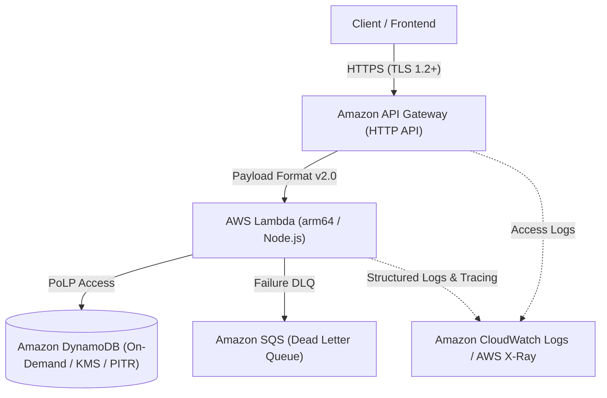

# ⚔️ Serverless Dual-Blade IaC

> **「宣言的か、型安全か——選ぶのではない、両方を極めるのだ。」**
> 高可用・低コスト・耐障害性を備えた完全サーバーレスREST API基盤を、**Terraform** と **AWS CDK (TypeScript)** の双方で完全に再現する「二刀流」インフラストラクチャ・リポジトリ。

---

## 🌟 プロジェクト概要

本プロジェクトは、AWSマネージドサービスを極限まで活用したサーバーレスアーキテクチャ（API Gateway HTTP API + Lambda + DynamoDB）を中核に据え、現代IaCの二大巨頭である **Terraform** と **AWS CDK** の両方で同一スペック・同一セキュリティ基準を満たす構成を実現した実践的モノレポです。

### 💡 インフラのハイライト
- **徹底したサーバーレス設計**: API Gateway HTTP API + AWS Lambda (Graviton2/arm64) + DynamoDB (オンデマンド) による従量課金・ゼロメンテ運用。
- **堅牢なセキュリティ & 耐障害性**: 最小権限IAMポリシー、保存時暗号化(KMS)、DynamoDB PITR(ポイントインタイムリカバリ)、SQSデッドレターキュー(DLQ)完備。
- **フルスタック可観測性**: CloudWatch Logs 構造化ログと AWS X-Ray アクティブトレースによるエンドツーエンドの分散トレーシング。
- **IaC二刀流 (Dual-Blade)**: Terraformによる宣言的ステート管理と、AWS CDKによるTypeScript型安全コンストラクトの両面から同一環境を再現可能。

---

## 📐 システムアーキテクチャ



---

## 📂 ディレクトリ構成

```text
.
├── apps/                         # Lambda アプリケーションコード (TypeScript)
│   └── src/
│       └── handler.ts
├── iac-terraform/                # 【Blade 1】Terraform 実装 (HCL)
│   ├── envs/
│   │   ├── dev/
│   │   └── prd/
│   ├── modules/
│   │   ├── api/
│   │   ├── compute/
│   │   └── database/
│   └── main.tf
└── iac-cdk/                      # 【Blade 2】AWS CDK 実装 (TypeScript)
    ├── bin/
    │   └── app.ts
    ├── lib/
    │   ├── api-stack.ts
    │   └── constructs/
    ├── cdk.json
    └── tsconfig.json
```

---

## 🚀 展開手順 (Getting Started)

### 前提条件
- AWS CLI (認証情報設定済み)
- Node.js 18+
- Terraform 1.5+
- AWS CDK CLI (`npm install -g aws-cdk`)

### 1. アプリケーションのビルド
```bash
cd apps
npm install
npm run build
cd ..
```

### 2. デプロイ方式の選択

#### 🗡️ Terraform で展開する場合
```bash
cd iac-terraform/envs/dev
terraform init
terraform plan
terraform apply
```

#### 🗡️ AWS CDK で展開する場合
```bash
cd iac-cdk
npm install
cdk synth
cdk deploy --all
```

---

## 🎬 キャスト & クレジット (エンドロール)

『AIアプリ工場劇場』の精鋭エージェントたちによる共創プロダクトです。

- **企画・要件定義**: agent🔵
  - 二刀流IaCという挑戦的なテーマを掲げ、堅牢なシステム要件を定義。
- **アーキテクチャ設計**: agent🍇
  - TerraformとCDKの境界線を見極め、統一感あるモノレポ設計を立案。
- **インフラ・コード実装**: agent🍊
  - 圧倒的な開発スピードで二刀流コードとLambdaハンドラーを具現化。
- **品質保証・検証**: agent🟢
  - 厳格なPoLPセキュリティ、トレーサビリティ、同等性検証を完遂。
- **総合プロデュース**: agent🟡
  - 劇場の全リソースを結集し、本リポジトリをワールドクラスへ昇華。