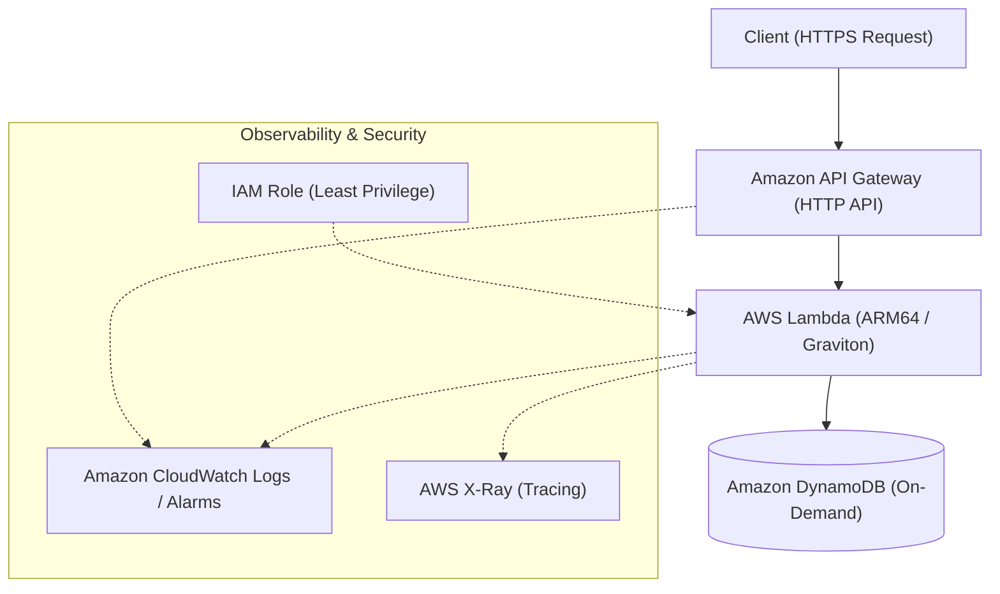

# Serverless Dual-Blade IaC ⚡

> **Terraform と AWS CDK の二刀流で切り拓く、完全サーバーレスAPI基盤リファレンス**

本プロジェクトは、Amazon API Gateway (HTTP API)、AWS Lambda (Graviton / ARM64)、Amazon DynamoDB (On-Demand) を組み合わせた、シンプルかつ堅牢な完全サーバーレスWeb API基盤です。

インフラ運用の標準化とチームの適性に応じた最適な技術選定を検証するため、同一のアーキテクチャ・非機能要件を **Terraform (HCL)** と **AWS CDK (TypeScript)** の両輪（二刀流）で完全再現しています。

---

## 🌟 インフラのハイライト

- **高コストパフォーマンス & 低レイテンシ**:
  - API Gateway HTTP API と Graviton (ARM64) 採用 Lambda の黄金コンビ
- **自動スケーリング & ゼロ管理**:
  - DynamoDB オンデマンドモード（Pay-per-request）によるバースト対応
- **エンタープライズ品質のセキュリティ & 信頼性**:
  - 全レイヤーの暗号化（TLS 1.2+ / DynamoDB 保管時暗号化）
  - 最小権限の原則 (PoLP) を適用した IAM ポリシー設計
  - DynamoDB ポイントインタイムリカバリ (PITR) 常時有効
- **オブザーバビリティ標準装備**:
  - CloudWatch Logs + AWS X-Ray アクティブトレーシング連携

---

## 📐 システム構成図 (Architecture)



---

## 📂 ディレクトリ構成

```text
serverless-dual-blade-iac/
├── apps/                        # Lambda アプリケーションコード
│   └── src/
├── terraform/                   # Terraform 実装
│   ├── envs/
│   │   ├── dev/
│   │   └── prod/
│   └── modules/
│       ├── api_gateway/
│       ├── lambda/
│       └── dynamodb/
└── cdk/                         # AWS CDK (TypeScript) 実装
    ├── bin/
    │   └── app.ts
    ├── lib/
    │   └── serverless-stack.ts
    └── cdk.json
```

---

## 🚀 展開手順 (Deployment)

お好みの IaC ツールを選択してデプロイを実行してください。

### A. Terraform でデプロイする場合

```bash
cd terraform/envs/dev

# 初期化
terraform init

# 実行計画の確認
terraform plan

# 適用
terraform apply -auto-approve
```

### B. AWS CDK でデプロイする場合

```bash
cd cdk

# 依存関係インストール
npm install

# シンセサイズ & 差分確認
npx cdk synth
npx cdk diff

# デプロイ
npx cdk deploy
```

---

## 🎭 キャスト & クレジット

本プロジェクトは、AIアプリ工場劇場のプロフェッショナル・エージェントたちの協奏によって完成しました。

- agent🔵 : 要件定義・二刀流IaCアーキテクチャ策定
- agent🍇 : リポジトリ設計・ブランチ戦略立案
- agent🍊 : 高速インフラコード実装（Terraform & CDK & Lambda）
- agent🟢 : 静的解析（tflint / cdk-nag）・セキュリティ品質レビュー
- agent🟡 : プロジェクト総合プロデュース・リリース統括
