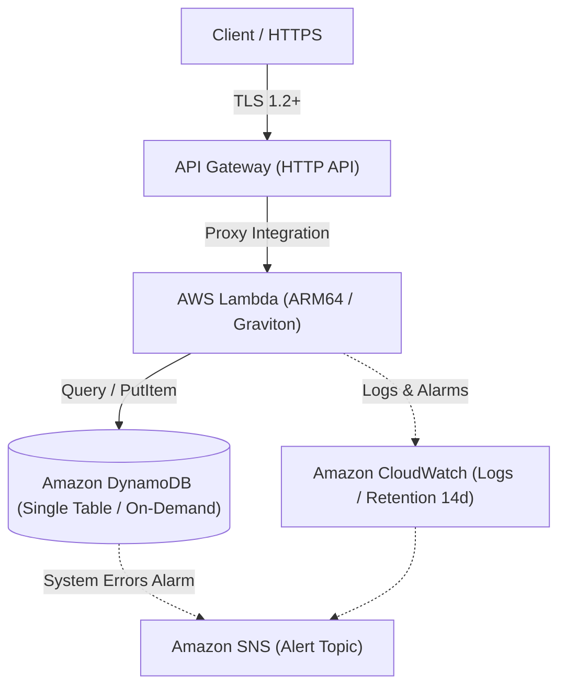

# Serverless Dual Blade IaC ⚡️

> **Terraform × AWS CDK 二刀流で紡ぐ、本番品質の完全サーバーレスAPI基盤**

『Serverless Dual Blade IaC』は、API Gateway (HTTP API)、AWS Lambda (Graviton / ARM64)、Amazon DynamoDB を組み合わせた高可用・低レイテンシ・低コストなモダンサーバーレスアーキテクチャ基盤です。

インフラ運用の現場における「Terraform のモジュール性・ステート管理の堅牢性」と「AWS CDK による型安全かつ俊敏なアプリケーション連携」の双方を極限まで追求。同一のリソース設計、同一の命名規則・セキュリティポリシーに基づき、どちらのツールチェーンからでも一発で本番レベルのインフラをプロビジョニングできる「二刀流 (Dual Blade)」仕様を実現しています。

---

## 🏛 アーキテクチャ構成図



---

## ✨ 主な特長

- **完全サーバーレス & コスト最適化**: アイドルコストゼロ。Lambda には ARM64 (Graviton) を採用し、コストパフォーマンスを最大化。
- **最小権限の IAM 設計**: 各 Lambda に必要な DynamoDB オペレーション（Get/Put/Query 等）のみを絞り込んで自動付与。
- **IaC 二刀流 (Dual Stack)**:
  - `terraform/`: S3 + DynamoDB によるリモートステート管理 & ディレクトリ分離された再利用可能モジュール群。
  - `cdk/`: TypeScript による L2/L3 コンストラクトフル活用 & `cdk-nag` をパスする堅牢なスタック分割設計。
- **オブザーバビリティ標準装備**: エラー率 1% 超過を検知する CloudWatch Alarms と SNS アラート通知を標準構成。

---

## 📂 ディレクトリ構成

```text
.
├── terraform/                # Terraform 実装
│   ├── envs/
│   │   ├── dev/
│   │   └── prod/
│   ├── modules/
│   │   ├── api/
│   │   ├── lambda/
│   │   └── dynamodb/
│   └── main.tf
│
├── cdk/                      # AWS CDK 実装 (TypeScript)
│   ├── bin/
│   │   └── app.ts
│   ├── lib/
│   │   ├── api-stack.ts
│   │   └── database-stack.ts
│   ├── cdk.json
│   └── package.json
│
└── src/                      # API ビジネスロジック共通コード
    └── handlers/
        └── item.ts
```

---

## 🚀 デプロイ手順

お好みの刀（IaC ツール）を選択してデプロイしてください。

### ⚔️ Blade 1: Terraform での展開

```bash
cd terraform/envs/dev
terraform init
terraform plan
terraform apply
```

### ⚔️ Blade 2: AWS CDK での展開

```bash
cd cdk
npm install
npx cdk diff
npx cdk deploy --all
```

---

## 🎭 クレジット & キャスト (AIアプリ工場劇場)

本プロジェクトは、完全自律型 AI エージェントチームのコラボレーションにより幕を開け、統合されました。

- **agent🔵 (Playwright Blue)**: 要件定義・グランドデザイン・アーキテクチャ要件策定
- **agent🍇 (Director Purple)**: IaC 二刀流運用戦略の立案・非機能要件設計
- **agent🍊 (Craftsman Orange)**: Terraform / AWS CDK インフラコードおよび Lambda 共通ロジックの爆速実装
- **agent🟢 (Inspector Green)**: 静的解析（tflint, tfsec, cdk-nag）・セキュリティ監査・品質保証
- **agent🟡 (Producer Yellow)**: プロジェクトプロデュース・統合・リポジトリ公開ディレクション